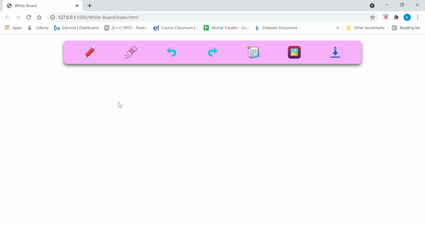
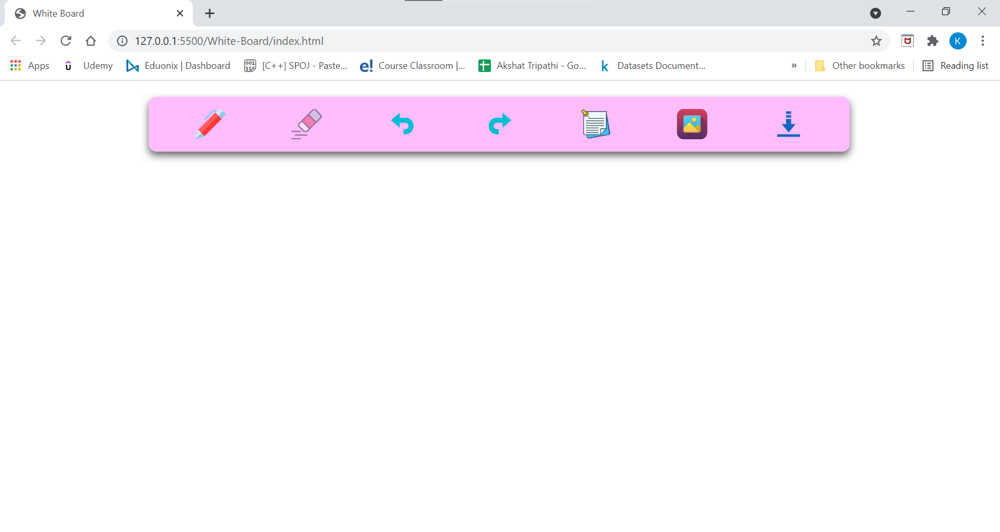

# White Board

A whiteboard that runs in the browser, built with plain HTML, CSS and JavaScript on the Canvas API. No frameworks, no build step.

**Live demo:** https://white-board-z563.vercel.app/



## Features

- **Pen** with adjustable size and five colours (black, yellow, blue, green, red)
- **Eraser** with adjustable size
- **Undo and redo**, stroke by stroke: every line is stored and the canvas is redrawn from that history
- **Sticky notes** you can type in, drag anywhere, minimise and close
- **Image upload**: drop a picture onto the board as a draggable sticky note
- **Download** the whole board as a JPG



## Run it locally

No install needed:

```bash
git clone https://github.com/meCeltic/white-board.git
cd white-board
open index.html        # or double-click index.html
```

## How it works

- Drawing uses the HTML5 Canvas 2D context, driven by mouse events.
- Each stroke is saved as a list of points, so undo and redo pop and push whole strokes and repaint the canvas.
- Sticky notes are positioned `div`s with a draggable header; image notes use a hidden file input and `URL.createObjectURL()`.
- Download exports the canvas with `canvas.toDataURL()`.

## Tech

HTML5 · CSS3 · JavaScript (ES6) · Canvas API · deployed on Vercel

## Author

Ankit Singh: [Portfolio](https://ankit-portfolio-liart.vercel.app) · [GitHub](https://github.com/meCeltic) · [LinkedIn](https://www.linkedin.com/in/ankit-singh-0a68281ba/)
